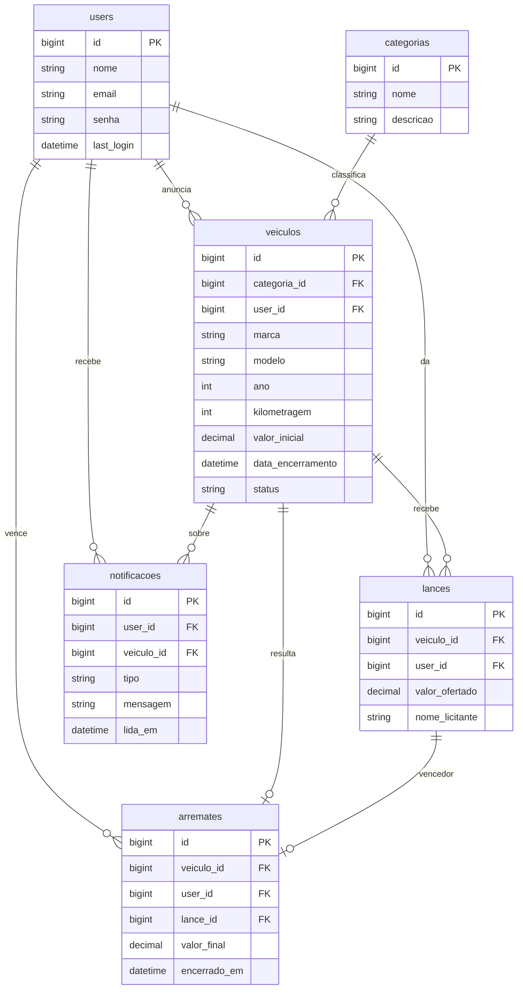

# 🚗 AuctionMotors

Sistema web de **leilão de veículos** desenvolvido em **Laravel 12** como projeto final da disciplina de **Desenvolvimento Web 2** do Curso Técnico em Informática do **IFPR – Campus Curitiba**.

Na plataforma, qualquer usuário cadastrado pode anunciar um veículo em leilão, dar lances nos veículos de outras pessoas e acompanhar tudo por notificações. Quando o prazo termina, o sistema encerra o leilão sozinho, registra o vencedor e gera o comprovante em PDF.

---

## 📋 Funcionalidades

| Módulo | O que faz |
|---|---|
| **Autenticação** | Cadastro de usuário, login e logout com sessão (senha criptografada com bcrypt, sessão regenerada no login). |
| **Veículos (CRUD)** | Cadastrar, listar, editar e excluir veículos. Só o dono pode editar/excluir, e leilão encerrado não pode ser editado. Exclusão lógica (Soft Delete). |
| **Categorias (CRUD)** | Carro, SUV, Moto, Caminhonete, Caminhão... Não é possível excluir uma categoria que ainda tem veículos. |
| **Vitrine** | Lista os leilões com paginação, filtro por categoria e status (Aberto/Encerrado). |
| **Lances** | Lance precisa ser maior que o atual; não dá pra dar lance no próprio veículo nem em leilão encerrado. Gravação com transação e *lock* para evitar dois lances iguais ao mesmo tempo. |
| **Arremates** | Ao passar a data de encerramento o leilão fecha automaticamente (comando agendado) e o vencedor é registrado. Página "Meus arremates". |
| **Notificações** | Sino na navbar com contador. Avisa quando o seu veículo recebe lance, quando seu lance é superado e quando o leilão termina. |
| **Relatórios PDF** | Relatório geral dos veículos (com filtro por categoria) e comprovante de arremate, gerados com `barryvdh/laravel-dompdf`. |
| **E-mail** | Ao cadastrar um veículo, o dono recebe um e-mail de confirmação (`Mailable`). |

### Funcionalidades dos seminários (Módulo 1) usadas no projeto
- **Geração de relatórios em PDF** – `barryvdh/laravel-dompdf`
- **Envio de e-mails transacionais** – `Mailable`
- **Paginação customizada** – `paginate()` + `withQueryString()` com estilo Bootstrap 5
- Também foram usados: **Form Requests com regra customizada**, **Soft Deletes**, **componentes Blade**, **mensagens flash** e **agendamento de tarefas (Task Scheduling)**.

---

## 🛠️ Tecnologias

- PHP 8.2+ e **Laravel 12**
- Blade + **Bootstrap 5** + Font Awesome
- **SQLite** (padrão) ou MySQL
- `barryvdh/laravel-dompdf` (PDF)

---

## ⚙️ Pré-requisitos

- **PHP 8.2 ou superior** com as extensões `pdo_sqlite`, `mbstring`, `openssl`, `fileinfo` e `dom` (usada pelo DomPDF)
- **Composer** 2.x
- Git

---

## 🚀 Como executar

```bash
# 1. Clonar o repositório
git clone https://github.com/AndriwArtista/AuctionMotors.git
cd AuctionMotors

# 2. Instalar as dependências do PHP
composer install

# 3. Criar o arquivo de configuração
cp .env.example .env          # no Windows (cmd): copy .env.example .env

# 4. Gerar a chave da aplicação
php artisan key:generate

# 5. Criar o banco SQLite
touch database/database.sqlite   # no Windows (PowerShell): New-Item database/database.sqlite

# 6. Criar as tabelas e popular com dados de teste
php artisan migrate --seed

# 7. Subir o servidor
php artisan serve
```

Acesse **http://127.0.0.1:8000**.

> **Usando MySQL?** No `.env`, troque `DB_CONNECTION=mysql` e preencha `DB_HOST`, `DB_PORT`, `DB_DATABASE`, `DB_USERNAME` e `DB_PASSWORD`. Crie o banco antes de rodar o passo 6.

### Encerramento automático dos leilões

Os leilões vencidos são fechados pelo comando `leiloes:encerrar`, agendado para rodar a cada minuto. Para deixar o agendador rodando em outro terminal:

```bash
php artisan schedule:work
```

Também dá pra rodar na mão: `php artisan leiloes:encerrar`. (A vitrine também encerra os leilões vencidos ao ser aberta, então o sistema funciona mesmo sem o agendador.)

### E-mails

Por padrão o `.env.example` usa `MAIL_MAILER=log`, ou seja, os e-mails são gravados em `storage/logs/laravel.log`. Para ver os e-mails numa caixa de entrada de teste, use o [Mailpit](https://github.com/axllent/mailpit) e configure:

```env
MAIL_MAILER=smtp
MAIL_HOST=127.0.0.1
MAIL_PORT=1025
```

### Resetar o banco

```bash
php artisan migrate:fresh --seed
```

---

## 👤 Usuários de teste

| Nome | E-mail | Senha |
|---|---|---|
| fulano | `fulano@exemplo.com` | `teste123` |
| fulano2 | `fulano2@exemplo.com` | `teste123` |

O seeder também cria mais 8 usuários aleatórios (senha `teste123`), 5 categorias, 25 veículos, dezenas de lances e alguns leilões já encerrados com arremate.

---

## 🗄️ Banco de dados



| Tabela | Descrição |
|---|---|
| `users` | Usuários do sistema (anunciantes e licitantes). |
| `categorias` | Tipos de veículo. |
| `veiculos` | Lotes em leilão. Pertence a um usuário e a uma categoria. |
| `lances` | Ofertas feitas em um veículo. |
| `arremates` | Resultado do leilão (1 por veículo): vencedor, lance vencedor e valor final. |
| `notificacoes` | Avisos exibidos no sino da navbar. |

---

## 🧭 Rotas principais

Todas as rotas, menos login e cadastro, exigem usuário logado (middleware `logged`).

| Método | URL | Descrição |
|---|---|---|
| GET/POST | `/login` · `/login-submit` | Login |
| GET/POST | `/registrar` | Cadastro de usuário |
| POST | `/logout` | Sair |
| GET | `/` | Vitrine de leilões (`?categoria=` filtra) |
| GET | `/veiculos/listar` | Meus veículos |
| GET/POST | `/veiculos/criar` · `/veiculos` | Cadastrar veículo |
| GET/PUT | `/veiculos/{id}/editar` · `/veiculos/{id}` | Editar veículo |
| DELETE | `/veiculos/{id}` | Excluir veículo |
| GET/POST | `/lances/{veiculo}` | Detalhes do leilão e dar lance |
| GET | `/arremates` | Meus arremates |
| GET/PATCH | `/notificacoes` | Notificações (marcar como lida) |
| resource | `/categorias` | CRUD de categorias |
| GET | `/relatorios/veiculos` | Relatório geral em PDF |
| GET | `/relatorios/arremates/{id}` | Comprovante de arremate em PDF |

Os IDs nas URLs são criptografados (`app/Services/Operations.php`) para não expor a sequência do banco.

---

## 📁 Estrutura do projeto

```
app/
├── Console/Commands/EncerrarLeiloes.php   # comando agendado leiloes:encerrar
├── Http/
│   ├── Controllers/                       # Auth, Veiculo, Lance, Categoria, Arremate, Notificacao, Relatorio
│   ├── Middleware/                        # CheckIsLogged / CheckIsNotLogged
│   └── Requests/                          # Form Requests de validação
├── Mail/LeilaoCriadoMail.php
├── Models/                                # User, Veiculo, Lance, Categoria, Arremate, Notificacao
├── Rules/LeilaoAberto.php                 # regra de validação customizada do lance
└── Services/                              # LeilaoService, NotificacaoService, Operations
database/
├── factories/                             # User, Categoria, Veiculo, Lance
├── migrations/
└── seeders/
resources/views/
├── components/                            # x-alert, x-flash, x-status-badge, x-campo
├── layout/ · partials/                    # layout base e navbar
├── veiculos/ · lances/ · categorias/ · arremates/ · notificacoes/
├── relatorios/                            # templates dos PDFs
└── emails/
routes/
├── web.php                                # rotas da aplicação
└── console.php                            # agendamento do leiloes:encerrar
```

---

## 👥 Autores

- **Andriw** – [@AndriwArtista](https://github.com/AndriwArtista)
- **Gustavo Pasini**

Professor: Jair José Ferronato – Desenvolvimento Web 2 – IFPR Campus Curitiba, 2026.
